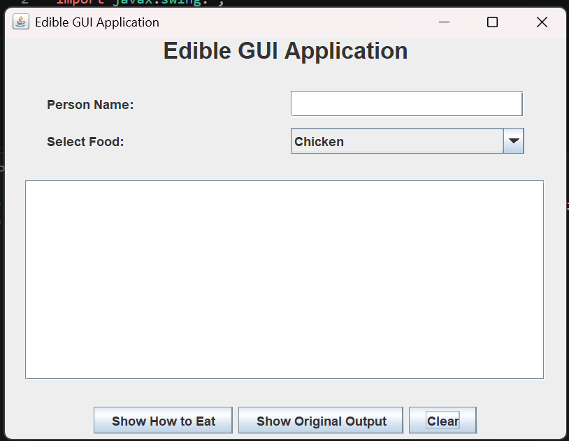

# Edible GUI Application

## Project Description

This project demonstrates Object-Oriented Programming (OOP)
concepts using Java Swing GUI and event handling.

The application allows users to select different food items
and display how they can be eaten.

## Features

- Enter a person's name
- Select food from a dropdown menu
- Display how the selected food can be eaten
- Show the original program output
- Clear inputs and results

## Java Concepts Used

- Interface (Edible)
- Abstract Class (Fruit)
- Inheritance
- Polymorphism
- JFrame and JPanel
- JLabel and JTextField
- JComboBox and JButton
- ActionListener and ActionEvent
- Event Handling using actionPerformed()

## GUI Screenshot

## How to Run

1. Download the repository.
2. Open the project folder in VS Code.
3. Compile the Java files:

   javac EdibleApp.java EdibleGUI.java

4. Run the GUI:

   java EdibleGUI

## Project Files

- EdibleApp.java - Original Java program
- EdibleGUI.java - Java Swing GUI implementation
- EdibleGUI.png - GUI screenshot
